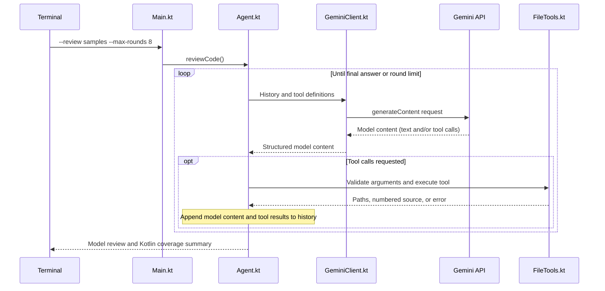

# Android Code Review Agent

A learning project that builds an AI code-review workflow with Kotlin/JVM and
Google Gemini function calling. Given a folder of Kotlin source files, the agent
asks the model to discover files, request their contents, and report bugs with
file paths, line numbers, explanations, and suggested fixes.

The model chooses which tools to request. Kotlin validates those requests,
executes the tools locally, and sends results back to the model. The agent is
read-only: it prints advice and does not edit the reviewed source.

## Current capabilities

- Discover `.kt` files recursively and read source with line numbers.
- Review multiple files and ask the model to consider calls between them.
- Maintain conversation history across model requests and tool results.
- Configure a maximum number of model requests (default: 8).
- Log model rounds, HTTP status, tool requests, results, and review text.
- Report discovered, successfully read, and skipped files, including after failures.
- Run local demonstrations and automated tests without an API key.

A live run against the two-file sample has read both files and identified the
intentional input-parsing bug. Cross-file bug detection and large-project
coverage have not yet been established by that sample.

## Repository layout

```text
AndroidCodeReviewAgent/
├── app/                         Android application module
├── agent/                       Kotlin/JVM console application
│   ├── build.gradle.kts
│   └── src/
│       ├── main/kotlin/com/anelcc/agent/
│       │   ├── Main.kt          Command selection and environment configuration
│       │   ├── Agent.kt         Review prompt, history, tool dispatch, bounded loop
│       │   ├── GeminiClient.kt  HTTP transport and response parsing
│       │   ├── FileTools.kt     Local filesystem access
│       │   ├── ReviewOptions.kt CLI settings and validation
│       │   └── ReviewCoverage.kt Coverage snapshot and console summary
│       └── test/kotlin/com/anelcc/agent/
├── samples/
│   ├── GreetingActivity.kt      Reads user input and calls the formatter
│   └── GreetingFormatter.kt     Produces the greeting text
├── reference/                   Earlier TypeScript example and sample inputs
├── gradle/                      Wrapper, version catalog, daemon configuration
├── build.gradle.kts
└── settings.gradle.kts
```

The agent runs on your computer as a JVM process. The Android app is a separate
module. Files in `samples/` are reviewed as text, not compiled into the agent;
no emulator is needed. `reference/` is not executed by the Kotlin agent.

## Technical stack

| Component | Implementation |
| --- | --- |
| Agent language | Kotlin; version catalog declares 2.2.10 |
| Agent toolchain | JDK 17 via `jvmToolchain(17)` |
| Gradle | Wrapper 9.4.1; Kotlin DSL build scripts |
| Gradle daemon JVM | Project requests JDK 21; separate from the agent toolchain |
| HTTP | Java's built-in synchronous `java.net.http.HttpClient` |
| JSON | `kotlinx-serialization-json:1.9.0`, JSON tree API |
| Model API | Gemini `generateContent` REST endpoint (`v1beta`) |
| Default model ID | `gemini-3.5-flash-lite`, overridable with `GEMINI_MODEL` |
| Tests | Kotlin test with JUnit integration; no live API calls |
| Android module | Android Gradle Plugin 9.2.1 and Jetpack Compose |

There is no agent framework, dependency-injection framework, or server.
The JSON tree API does not require the Kotlin serialization compiler plugin.
Use the Gradle wrapper rather than installing Gradle separately.

## Architecture and agent loop



`Main.kt` passes `client::generateContent` into `Agent`. That function reference
lets the agent request model content while tests substitute scripted responses.
The complete model content is preserved between requests, including any thought
signatures. Function results use matching call IDs when provided by Gemini.

| Model-facing tool | Kotlin function | Contract |
| --- | --- | --- |
| `list_files` | `FileTools.listFiles()` | No arguments; returns relative Kotlin paths |
| `read_file` | `FileTools.readFile(path)` | Exactly one nonblank string `path`; returns numbered source |

Paths must remain within the configured review root after normalization and
real-path resolution. Absolute read paths and files outside the root, including
symlink targets outside it, are rejected. Reads accept only `.kt` files up to
100,000 bytes. File discovery does not follow directory symlinks. Tool errors
are returned as JSON results so the model can report limitations.

A round is one request to Gemini, not one file. Multiple tool calls may appear
in a response; Kotlin executes them sequentially. The final review needs a
model request too. The loop ends on a text response without tool calls, or fails
at the configured limit. It does not force the model to read every file.

## Setup

Run all commands below from the repository root (the folder containing `gradlew`).
Examples use macOS with **zsh**.

### 1. Configure Java

Install Android Studio and its project-required Android SDK components, or use
an existing suitable JDK setup. Gradle may download its configured JVM toolchains
on the first build. The agent targets JDK 17; the Gradle daemon requests JDK 21.

On macOS, Android Studio's bundled JDK can bootstrap Gradle:

```zsh
export JAVA_HOME="/Applications/Android Studio.app/Contents/jbr/Contents/Home"
export PATH="$JAVA_HOME/bin:$PATH"
java -version
```

These exports affect the current terminal only. A new terminal needs them again
unless Java has been configured persistently on your machine.

### 2. Build and test locally

```zsh
./gradlew :agent:build
./gradlew :agent:test
```

Tests use local fixtures and simulated model responses. They cover response
parsing, tool execution, invalid paths and arguments, CLI settings, round limits,
and coverage during complete, partial, and failed runs. They require no API key;
the first Gradle run may need internet access for dependencies and toolchains.

### 3. Create your own Gemini API key

Open [Google AI Studio API keys](https://aistudio.google.com/api-keys), select
your project, and create a key. For no-cost learning, use a project marked
**Free tier** and keep it on that tier. Model availability and quotas depend on
the project; some projects may require verification. See Google's
[API key documentation](https://ai.google.dev/gemini-api/docs/api-key) and
[current pricing and free-tier availability](https://ai.google.dev/gemini-api/docs/pricing).

Each developer supplies their own key. The repository contains no shared key.
The client cannot detect your billing tier and does not configure billing.

### 4. Enter the key without displaying or committing it

Run the following lines separately in zsh:

```zsh
read -s "GEMINI_API_KEY?Gemini API key: "
export GEMINI_API_KEY
echo
```

At the prompt, paste your key and press Enter. Input stays hidden, and the key
is not included in the typed command saved to shell history. `export` lets the
Gradle process and agent read it with `System.getenv("GEMINI_API_KEY")`.
This keeps the secret out of project files; it is still present in the process
environment. Do not run `echo "$GEMINI_API_KEY"`, share it in chat or screenshots,
or include it in source, Gradle properties, an Android APK, or commits.
The application does not load `.env` files automatically.

The key applies only to the current terminal session. In a new terminal, repeat
Java setup and key entry. When finished, clear it with:

```zsh
unset GEMINI_API_KEY
```

If a key is exposed, revoke it in AI Studio and create a replacement. Removing
it from a file alone does not revoke it or erase Git history.

### 5. Check the connection and run a review

```zsh
./gradlew :agent:run --args="--gemini"
./gradlew :agent:run --args="--review"
```

The connection check sends a fixed text prompt. The review sends requested
source code to Google. Free-tier content may be used to improve Google's
products under its terms; use the toy samples or code you are authorized to
share. The key is sent in the `x-goog-api-key` HTTP header and is not logged.

## Commands and configuration

| Command | Behavior |
| --- | --- |
| `./gradlew :agent:run` | Local demo: list and read sample files; no model request |
| `./gradlew :agent:run --args="--gemini"` | One text-only connection check |
| `./gradlew :agent:run --args="--review"` | Review `samples/`, up to eight rounds |
| `./gradlew :agent:run --args="--review samples --max-rounds 12"` | Review with a custom request limit |
| `./gradlew :agent:run --args="--review app/src/main/java"` | Review that Android source folder |
| `./gradlew :agent:clean` | Remove generated agent build outputs |

The review folder can be relative to the repository root or absolute. Prefer a
small source folder rather than the entire repository: discovery currently has
no build-folder or Git-ignore exclusions and no total file/token budget.
`--max-rounds` accepts a positive whole number. More rounds permit more requests
and can consume more quota; the agent stops early when it has a final answer.

| Environment variable | Required? | Purpose |
| --- | --- | --- |
| `GEMINI_API_KEY` | For `--gemini` and `--review` | Private authentication credential |
| `GEMINI_MODEL` | No | Public model ID; defaults to `gemini-3.5-flash-lite` |

To explicitly select the default model:

```zsh
export GEMINI_MODEL="gemini-3.5-flash-lite"
```

Find model IDs and supported capabilities in Google's
[model catalog](https://ai.google.dev/gemini-api/docs/models). Changing the model
does not change your project's tier or guarantee availability. The earlier
`--discover` command has been replaced by `--review`.

## Reading logs and coverage

A successful two-file sample review may finish with:

```text
[model request] review round=3/8
[model HTTP] status=200
[model response] ...findings...
[coverage] final answer received=true
[coverage] discovered=2, read=2, skipped=0
```

Coverage is measured by Kotlin tool execution, independently of model claims:

- **Discovered:** distinct paths from successful listings.
- **Read:** distinct normalized paths successfully read by the file tool.
- **Skipped:** discovered paths minus successful reads, including failed reads.
- **Final answer received:** the model returned text without tool calls.

The coverage summary runs in `finally`, so it also appears after an API failure
or round-limit stop. Without a successful listing, total coverage is unknown.
A read proves local tool access, not complete or correct model analysis. Reviews
can end with skipped files; they are reported rather than automatically retried.
Logs include source contents and findings, so inspect them before sharing output.

## Troubleshooting

| Symptom | Next action |
| --- | --- |
| Unable to locate a Java Runtime | Repeat Java setup in this terminal |
| `Set GEMINI_API_KEY...` | Repeat hidden key entry and export in this terminal |
| HTTP 400, 401, or 403 | Check key configuration, project permissions, and the request settings |
| HTTP 404 | Check the model ID and its availability to your project |
| HTTP 429 | Check free-tier quotas in AI Studio; do not repeatedly retry or enable billing to resolve this project's setup |
| HTTP 503 | Retry later; a new command starts a fresh review |
| Round limit reached | Inspect coverage; use a smaller folder or a suitable `--max-rounds` value |

No automatic retries, paid fallback, or resume/checkpoint mechanism is
implemented. HTTP connection timeout is 20 seconds; request timeout is 90
seconds. A network/service failure can leave all files read but no final review.

## Scope and next improvements

This is an educational reviewer, not a replacement for a compiler, Android Lint,
tests, or human review. It does not run the Android app or verify suggested
patches. Review format and evidence rules are prompt instructions, not a strict
output schema; model findings can be wrong or incomplete.

Next experiments include a known bug spanning two files, a corrected sample to
check false positives, and a small real Android source folder. Bounded retries,
file exclusions, and total input budgets are future reliability improvements.
